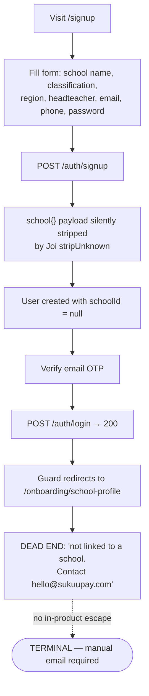
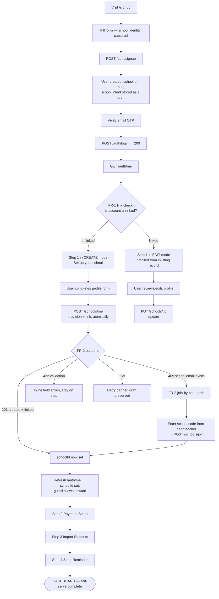
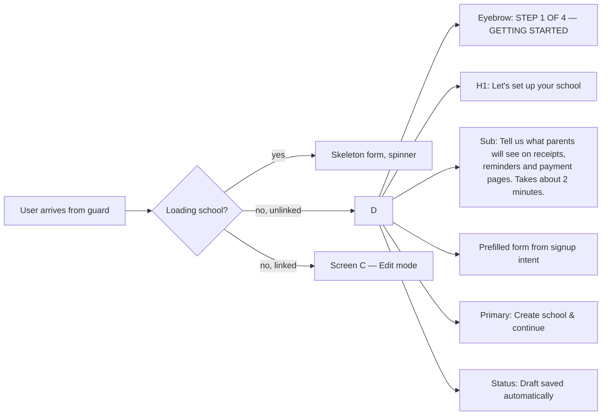
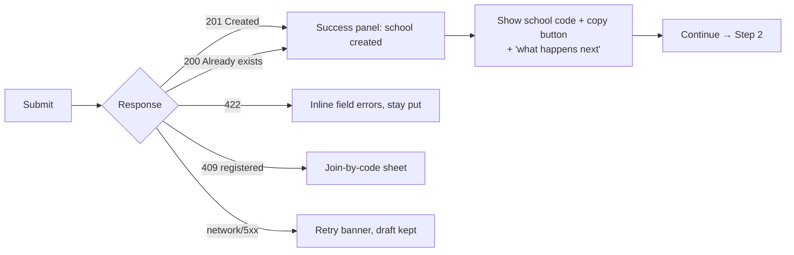

# School Provisioning During Onboarding — Functional Requirement & User Flow

> Status: **Implemented**. Backend, frontend and mock layers all landed; see §7 for
> what shipped and §8 for the deviations from the original proposal.
>
> Spec: this document. Implementation record: §7. Tests: `tests/schoolProvisioning.test.js`
> (backend, 47 assertions) and `.mockcheck/entry.js` (frontend, 72 checks).
>
> Primary files (Backend): `src/controllers/authController.js`,
> `src/controllers/school.controller.js`, `src/services/school.service.js`,
> `src/routes/school.routes.js`, `src/validations/school.validation.js`,
> `src/validators/authValidators.js`, `src/models/userModel.js`,
> `src/models/SchoolJoinRequest.js` (new), `src/middleware/requireSchool.js` (new),
> `src/utils/accountLink.js` (new), `src/utils/schoolTypeMapping.js` (new),
> `scripts/audit-unlinked-users.js` (new, read-only).
> Primary files (Frontend): `src/context/AuthContext.jsx`, `src/routes/OnboardingGuard.jsx`,
> `src/pages/onboarding/Step1SchoolProfile.jsx`, `src/services/school.js`,
> `src/services/auth.js`, `src/services/api.js`, `src/pages/auth/Signup.jsx`,
> `src/components/onboarding/JoinSchoolSheet.jsx` (new),
> `src/components/onboarding/ReceiptPreview.jsx` (new),
> `src/mocks/handlers.js`, `src/mocks/db.js`, `src/mocks/scenarios.js`, `src/mocks/adapter.js`.
>
> Note: this repo keeps validators in two different directories — auth at
> `src/validators/authValidators.js`, everything else at `src/validations/*.validation.js`.


---

## 0. Executive Summary

**Every self-service signup in SukuuPay currently dead-ends.** A new user signs up, verifies
their email, signs in, and is redirected into Step 1 of the onboarding wizard, where they are
told their account is not linked to a school and to email support. There is no code path by
which a self-service user can ever obtain a `schoolId`.

This document specifies the fix: an unlinked account is granted a **school provisioning
path** — it creates its own School record and is linked to it atomically — instead of being
shown an error. The "is this account unlinked?" check already exists implicitly
(`user.schoolId === null`); what is missing is any action attached to the `true` branch.

**Three deliverables requested, mapped to sections below:**

| # | Deliverable | Section |
|---|---|---|
| 1 | Updated user journey for a new user | [§2](#2-updated-user-journey) |
| 2 | Conditional logic for the system check | [§3](#3-conditional-logic-system-check) |
| 3 | Proposed UI/UX flow for the school profiling stage | [§4](#4-proposed-uiux-flow-for-the-school-profiling-stage) |

---

## 1. Current State — Root Cause Trace

The dead end is not a missing edge case. It is the *only* reachable state for a
self-service signup, and it is produced by five independent pieces of code that never
talk to each other.

| # | Step | Evidence |
|---|---|---|
| 1 | The signup form **does** collect school identity — name, classification, region — and ships it as a nested `school` object. | `frontend/src/pages/auth/Signup.jsx:248-259` |
| 2 | `signupSchema` **has no `school` key**. | `Backend/src/validators/authValidators.js:15-21` |
| 3 | `validate` middleware runs Joi with `stripUnknown: true`, so the nested `school` object is **silently discarded** — no error, no warning. | `Backend/src/middleware/validate.js:40-44` |
| 4 | `signup` then creates the User **without ever setting `schoolId`**, which defaults to `null`. | `Backend/src/controllers/authController.js:48-57`; `Backend/src/models/userModel.js:47-52` |
| 5 | After login, `GET /auth/me` returns that user. `OnboardingGuard` sees `onboardingCompleted === false` and bounces `/dashboard` → `/onboarding/school-profile`. | `OnboardingGuard.jsx:45-47`; `App.jsx:77` |
| 6 | Step 1 finds no `schoolId` and renders the amber terminal card: *"This account is not linked to a school yet. Contact the SukuuPay desk…"* | `Step1SchoolProfile.jsx:298-315` |
| 7 | Even if that card were removed, the save handler independently hard-fails with *"Your account is not linked to a school yet. Contact support to finish setup."* | `Step1SchoolProfile.jsx:258-261` |

### 1.1 Why no self-service user can currently get a `schoolId`

`POST /schools` — the only route that creates a School — is gated behind `authorize("super_admin")`.

- `Backend/src/routes/school.routes.js:25-32`
- `Backend/src/services/school.service.js:21` (`createSchool`)

So today the **only** way to onboard a school is a platform operator creating it by hand in
the admin tool, then manually assigning `user.schoolId`. Signup captures the school name from
the user and throws it away.

### 1.2 Two latent data bugs that will break the provisioning path if left alone

These are discovered while tracing and must be fixed as part of this work, because the new
"create my school" flow feeds signup data straight into `School`.

**(a) Classification values are not valid `School.type` values.**

`Signup.jsx:344` renders options from `SCHOOL_CLASSIFICATIONS`
(`frontend/src/utils/constants.js:77-83`):

| Signup offers | `School.type` accepts |
|---|---|
| `private`, `international` | `private`, `international` ✅ |
| `senior_high` | ❌ not in enum |
| `university` | ❌ not in enum |

`School.type` enum is `public | private | international | mission | charter`
(`Backend/src/models/schoolModel.js:25-29`, enforced by `createSchoolSchema`
at `Backend/src/validations/school.validation.js:26-29`). A user who picks *Senior High
School* would collect a school name, then hit a `422` from a schema they never saw.
**A mapping table is required** — see §3.4.

**(b) The classification is written to the wrong field.**

`Signup.jsx:252` sends `position: form.schoolClassification`. `User.position` is documented
as the job title — *"e.g. Headmaster, Accountant, Founder"* (`userModel.js:35-39`) — while
`form.principalName` is the actual person and is sent as `User.name`. So every new account
carries a job title of `"senior_high"`. `principalName` should map to `position`.

### 1.3 What is already correct and must not regress

- Draft persistence per step (`useOnboardingProgress.js`) — a half-typed school profile survives a refresh. Keep it.
- URL-per-step navigation with a locked stepper (`OnboardingLayout.jsx:40-48`) — refresh and browser-back both behave. Keep it.
- Server-generated `slug` and `schoolCode` with collision loops (`generateCode.js:31-77`) — a provisioning flow must reuse these, never let the client pick them.
- Auto-granted 30-day trial subscription (`school.service.js:37-54`) — new schools must land on `plan: trial`, not a blank subscription.
- Honest failure reporting when an API route is absent (`services/school.js:37-55`, `handlers.js` mock-only routes). The new flow must be honest in the same way.

---

## 2. Updated User Journey

### 2.1 Today (broken)



### 2.2 Proposed



### 2.3 Stage-by-stage journey for a new user

| Stage | Screen | User sees | System does | Success criterion |
|---|---|---|---|---|
| S0 | `/signup` | Single form: school name, classification, region, headteacher, work email, phone, password | `POST /auth/signup` creates User; school intent retained as a **draft** (not a School) | Account exists, verification mail sent |
| S1 | `/verify-email` | 6-digit code, resend, expiry countdown | `POST /auth/verify-email/:token` | `isEmailVerified = true` |
| S2 | `/login` | Email + password | `POST /auth/login` issues tokens | Session established |
| S3 | *(automatic)* | **No error screen.** Redirect to onboarding | Guard runs **FR-1** | Lands on Step 1 |
| S4 | Step 1 **CREATE mode** | *"Let's set up your school"* — form prefilled from S0 intent, `Create school & continue` | Renders `SchoolForm`; prefills only from the user's own draft | User sees their own data, not a blank wall |
| S5 | Step 1 submit | Spinner on button; `Creating your school…` | `POST /schools/me` → creates School (trial plan, generated `slug`/`schoolCode`), sets `user.schoolId`, returns updated user | `201` with `{ school, user }` |
| S6 | Step 1 success | Green confirmation + **school code displayed** + "Continue to payment setup" | `setSchool()` in AuthContext; `unlockStep(1)` | `user.schoolId` is non-null |
| S7 | Steps 2–4 | Existing wizard, unchanged | Existing behaviour | Existing behaviour |
| S8 | `/dashboard` | Full app | Guard now permits dashboard | Journey complete |

### 2.4 Recovery and edge-case journeys

These matter as much as the happy path — they are where dead ends breed.

| Situation | Detected by | Journey | Terminal? |
|---|---|---|---|
| Signed-up but abandoned before verifying | `isEmailVerified === false` | Already blocked at login by `EMAIL_NOT_VERIFIED` (`authController.js:135-141`) | No — resend path exists |
| Verified, then abandoned; returns on another device | `schoolId === null` | Re-enters Step 1 CREATE mode. **Requires server-side `onboardingCompleted`** — see FR-9 | No |
| Second admin of an already-registered school | `School.email` unique → `409 DUPLICATE_EMAIL` | FR-3 join-by-code, not an error | No |
| `schoolId` set but points at a deleted school | `School.deletedAt != null` | `GET /schools/:id` → `404` → treat as unlinked, offer re-provision | No |
| `super_admin` with no `schoolId` | `role === 'super_admin'` | Bypasses provisioning; goes straight to the platform admin surface. **Must not** be forced to create a school | No |
| Account suspended / deactivated | `status` in `authController.js:131-133` | Login refused | Yes — by design, and correct |
| Provisioning succeeds but link write fails | Transaction rollback | Nothing persisted; user stays in CREATE mode with draft intact | No |
| Duplicate submit (double-click / flaky network) | Idempotency key, §3.5 | Returns the **same** school, `200` not `409` | No |

---

## 3. Conditional Logic — System Check

### 3.1 FR-1 — The unlinked-account check (primary requirement)

> **FR-1.** The system shall detect, on every authenticated entry into the product, whether
> the account is linked to a school, and shall grant an unlinked account access to the
> school provisioning module instead of terminating the journey.

**Single source of truth: `user.schoolId`, evaluated server-side.** The frontend already
receives this field; no new boolean is needed to make the decision. The rule below is the
*authoritative* implementation, and it is the same rule reported back to the client by FR-2 —
so the two can never disagree.

```js
// Backend — the authoritative rule. Exported so FR-2 and FR-6 share one definition.
export const resolveAccountLinkState = (user) => {
  if (!user) return { linked: false, reason: 'ANONYMOUS', schoolId: null };

  // Platform staff legitimately have no school; they are never sent to provisioning.
  if (user.role === 'super_admin') {
    return { linked: true, reason: 'PLATFORM_STAFF', schoolId: null };
  }

  if (!user.schoolId) {
    return { linked: false, reason: 'UNLINKED', schoolId: null };
  }

  return { linked: true, reason: 'LINKED', schoolId: user.schoolId };
};
```

**Frontend consumer — `AuthContext` exposes it, `OnboardingGuard` acts on it:**

```jsx
// AuthContext.jsx — `linkState` comes straight off the /auth/me `onboarding` block
// (FR-2). The client must NOT re-derive it from user.schoolId: the server already
// encoded the super_admin and dangling-reference cases, and duplicating the rule
// here is how the two sides drift.
const { user, onboarding, loading } = useAuth();

const linkState = onboarding;   // { linked, reason, schoolId, completed, nextRoute }
const onboardingCompleted = onboarding?.completed === true;
const needsSchoolProvisioning = Boolean(user) && linkState?.linked === false;

// OnboardingGuard.jsx
const OnboardingGuard = () => {
  const { user, loading, onboardingCompleted } = useAuth();
  const location = useLocation();

  if (loading) return <FullPageSpinner />;
  if (!user) return <Navigate to={ROUTES.LOGIN} state={{ from: location }} replace />;

  const isOnboardingPath = location.pathname.startsWith(ROUTES.ONBOARDING);
  const isDashboardPath = location.pathname === ROUTES.DASHBOARD;

  // FR-1: an unlinked account is *not* finished onboarding — it has not started.
  // The old code already routes it to /onboarding; what changes is that
  // /onboarding/school-profile no longer terminates (see Step1 mode switch).
  //
  // FR-1b: an unlinked account must never reach the dashboard. Any later step
  // (payment setup, student import) has no school to act on.
  const canEnterDashboard = onboardingCompleted && linkState.linked;

  if (!canEnterDashboard && isDashboardPath) {
    return <Navigate to={ROUTES.ONBOARDING} replace />;
  }

  if (onboardingCompleted && linkState.linked && isOnboardingPath) {
    return <Navigate to={ROUTES.DASHBOARD} replace />;
  }

  return <Outlet />;
};
```

> **Why `linkState.linked` is added to the dashboard condition.** Today
> `OnboardingGuard.jsx:41-43` redirects *out* of onboarding only when
> `onboardingCompleted` is true. Because `onboardingCompleted` lives in `localStorage`
> (`AuthContext.jsx:20-23`) and is not tied to `schoolId`, a user can have
> `onboardingCompleted === true` and `schoolId === null` at the same time — e.g. an
> unlinked invitee who inherited a flag, or a platform test account. Gating the
> dashboard on **both** conditions closes that hole.

### 3.2 FR-2 — Server reports link state explicitly

> **FR-2.** `GET /auth/me` shall return a machine-readable onboarding state alongside the
> user, so the client does not infer intent from a nullable field.

```js
// authController.js — me
export const me = async (req, res) => {
  const linkState = resolveAccountLinkState(req.user);

  return res.status(200).json({
    success: true,
    message: 'Current user retrieved',
    user: req.user.toJSON(),
    onboarding: {
      ...linkState,
      // Server-side, device-independent — replaces the localStorage flag (FR-9).
      completed: req.user.onboardingCompleted === true,
      highestStep: req.user.onboardingHighestStep ?? 0,
      // What the client should render next. One source of truth for routing.
      nextRoute: linkState.linked
        ? (req.user.onboardingCompleted ? ROUTES.DASHBOARD : ROUTES.ONBOARDING)
        : `${ROUTES.ONBOARDING}/school-profile`,
    },
  });
};
```

### 3.3 FR-4 — The Step 1 mode switch (where the dead end is removed)

> **FR-4.** `Step1SchoolProfile` shall render in **create mode** when the account is
> unlinked and **edit mode** when it is linked. Create mode shall never render a
> terminal error state.

```jsx
// Step1SchoolProfile.jsx
const { user, refreshUser, setSchool } = useAuth();
const schoolId = user?.schoolId;
const mode = schoolId ? 'edit' : 'create';   // ← the fix, in one line

// Prefill from the signup draft the user filled at S0. This is why signup's
// school intent must be retained rather than discarded (see §1, step 3).
const prefills = useMemo(() => getSignupIntentDraft() ?? {}, []);

useEffect(() => {
  if (mode === 'edit') { /* existing hydrate-from-server effect, unchanged */ }
  else { setForm((c) => ({ ...c, ...prefills, email: prefills.email || user?.email || '' })); }
}, [mode, schoolId]);

const saveRef = useRef(null);
saveRef.current = async () => {
  setSaving(true);
  setFormError('');
  try {
    if (mode === 'create') {
      // The old dead end, replaced with the action the user actually needs.
      const { school, user: updated } = await provisionMySchool(toPayload(form, logoUrl));
      setSchool(school);
      await refreshUser(updated);          // schoolId is now set
      toast.success(`${school.name} is set up.`);
    } else {
      await updateSchool(schoolId, toPayload(form, logoUrl));
      toast.success('School profile saved.');
    }
    return true;
  } catch (error) {
    setFormError(error.message || 'We could not save your school details.');
    toast.error(error.message || 'We could not save your school details.');
    return false;                          // stay on the step; draft survives
  } finally {
    setSaving(false);
  }
};

useEffect(() => {
  register({
    valid: isValid && !saving,
    busy: saving,
    label: mode === 'create' ? 'Create school & continue' : 'Continue',
    onSubmit: () => saveRef.current(),
  });
}, [isValid, saving, mode, register]);

// ❌ DELETED: the `if (!schoolId) return <amber dead-end card>` block
//    (currently Step1SchoolProfile.jsx:298-315) and the
//    "Contact support to finish setup" branch (lines 258-261).
```

The action-bar plumbing already exists and needs no change — `OnboardingStepContext`
exposes `register({ valid, busy, label, onSubmit })` and `OnboardingLayout.jsx:75-87`
awaits `onSubmit` and refuses to advance when it returns `false`.

### 3.4 FR-5 — `POST /schools/me`: provision and link, atomically

> **FR-5.** An authenticated, non-`super_admin` account with no `schoolId` shall be able to
> create its own School and be linked to it in a single atomic operation.

**Route** — `Backend/src/routes/school.routes.js`. Placed *before* `schoolRoute.post("/schools", …)`
only for readability; the paths do not collide.

```js
// Deliberately NOT authorize("super_admin") — this is the self-service route.
schoolRoute.post(
  "/schools/me",
  authenticate,
  provisionMySchoolSchema,           // own validator; see below
  createMySchoolController
);
```

**Validator** — `Backend/src/validations/school.validation.js`. Reuses `createSchoolSchema`'s
field rules (every field `School` requires) and adds the signup-classification mapping from §1.2(a):

```js
import { signupClassificationToSchoolType, classifySchoolType } from "../utils/schoolTypeMapping.js";

export const provisionMySchoolSchema = Joi.object({
  name: Joi.string().trim().min(2).max(150).required(),
  // Accepts EITHER the School.type enum OR a signup classification value,
  // and normalises to School.type. Fixes the senior_high/university 422.
  type: Joi.string()
    .valid("public", "private", "international", "mission", "charter",
           "senior_high", "university")
    .required()
    .custom((value, helpers) => {
      const mapped = signupClassificationToSchoolType(value);
      if (!mapped) return helpers.error("any.invalid");
      return mapped;
    }),
  phone: phoneValidator,
  email: emailValidator,
  address: Joi.string().trim().min(5).max(300).required(),
  city: Joi.string().trim().min(2).max(100).required(),
  region: Joi.string().valid(...ghanaRegions).required(),
  motto: Joi.string().trim().max(200).allow("").optional(),
  yearFounded: Joi.number().integer().min(1800).max(currentYear).optional(),
  gpsAddress: Joi.string().trim().max(200).allow("").optional(),
  website: Joi.string().uri().trim().allow("").optional(),
}).min(1);
```

**Classification mapping** — new `Backend/src/utils/schoolTypeMapping.js`. Bidirectional and
lossy-in-one-direction only; `senior_high` / `university` collapse to their closest
`School.type`, and the collapse must be surfaced to the user, not hidden.

```js
// Signup's SCHOOL_CLASSIFICATIONS -> School.type enum (schoolModel.js:25-29).
const CLASSIFICATION_TO_TYPE = {
  private: 'private',
  international: 'international',
  // No 'senior_high' or 'university' in the School enum. Best available match;
  // the UI must show a hint so the bursar can correct it later in Settings.
  senior_high: 'public',
  university: 'private',
};

// School.type -> the classification label to preselect, for the reverse direction.
const TYPE_TO_DEFAULT_CLASSIFICATION = {
  public: 'senior_high',
  private: 'private',
  international: 'international',
  mission: 'senior_high',
  charter: 'senior_high',
};

export const signupClassificationToSchoolType = (v) => CLASSIFICATION_TO_TYPE[v] ?? null;
export const schoolTypeToClassification = (v) => TYPE_TO_DEFAULT_CLASSIFICATION[v] ?? 'private';
export const isLossyClassification = (v) =>
  CLASSIFICATION_TO_TYPE[v] != null && !Object.keys(CLASSIFICATION_TO_TYPE).includes(v);
```

**Service** — extend `school.service.js`. Reuses `generateUniqueSlug`, `generateSchoolCode`,
`validateGhanaPhone` and the trial-subscription block so a self-provisioned school is
byte-identical to an operator-created one.

```js
/**
 * Create the caller's own school and link them to it.
 *
 * The link write and the School insert must share a session so a failure cannot
 * leave an orphan School that nobody administers.
 */
export const provisionSchoolForUser = async (data, user, { session } = {}) => {
  if (user.role === 'super_admin') {
    throw new ApiError('Platform staff accounts are not linked to a school', 403, 'FORBIDDEN');
  }
  if (user.schoolId) {
    // Already provisioned. Return the existing school rather than erroring —
    // this makes the endpoint idempotent for a double-submitted form.
    const existing = await School.findOne({ _id: user.schoolId, deletedAt: null });
    if (existing) return { school: existing.toJSON(), user, created: false };
    // Dangling reference: the school was archived. Treat the user as unlinked.
  }

  const { email, phone } = data;
  const existingEmail = await School.findOne({ email });
  if (existingEmail) {
    throw new ApiError(
      'A school with this email is already registered. Enter your school code to join it instead.',
      409,
      'SCHOOL_ALREADY_REGISTERED',
    );
  }

  const validatedPhone = validateGhanaPhone(phone);
  if (!validatedPhone) throw new ApiError('Invalid Ghana phone number format', 400, 'INVALID_PHONE');

  const slug = await generateUniqueSlug(data.name);
  const schoolCode = await generateSchoolCode(data.name);

  const trialEndsAt = new Date();
  trialEndsAt.setDate(trialEndsAt.getDate() + 30);

  const session_ = session ?? await mongoose.startSession();
  try {
    return await session_.withTransaction(async () => {
      const school = await School.create([{
        ...data,
        phone: validatedPhone,
        slug,
        schoolCode,
        createdBy: user._id,
        status: 'active',
        subscription: {
          plan: 'trial', status: 'trial', trialEndsAt,
          currentPeriodStart: new Date(), currentPeriodEnd: trialEndsAt,
        },
      }], { session: session_ })[0];

      user.schoolId = school._id;
      await user.save({ session: session_ });   // ← atomic link

      await auditService.log({
        action: 'PROVISION', entity: 'School', entityId: school._id,
        userId: user._id, details: { name: school.name, schoolCode: school.schoolCode },
      });

      return { school: school.toJSON(), user: user.toJSON(), created: true };
    });
  } finally {
    if (!session) await session_.endSession();
  }
};
```

**Controller** — thin, matching the existing style in `school.controller.js`:

```js
export const createMySchoolController = async (req, res) => {
  try {
    const result = await provisionSchoolForUser(req.body, req.user);
    return res.status(result.created ? 201 : 200).json({
      success: true,
      message: result.created ? 'School created and linked to your account' : 'School already linked',
      data: result.school,
      user: result.user,               // frontend swaps this into AuthContext
    });
  } catch (error) {
    return res.status(error.status || 500).json({ success: false, message: error.message, code: error.code });
  }
};
```

> **`createdBy` is `required` on the School model** (`schoolModel.js:229-233`) and is
> satisfied by `user._id`. Note that `User` has a **unique** `email` but `School` has a
> **unique** `email` too — so a self-service school *defaults* to the same address as the
> bursar's login. That is the intended relationship, and it is precisely why §3.4's
> `409` branch must offer join-by-code rather than a dead end.

### 3.5 FR-3 — Join-by-code (the second-admin path)

> **FR-3.** When a user tries to provision a school whose email is already registered, the
> system shall offer a join flow authenticated by the school's code rather than an error.

```js
// school.routes.js
schoolRoute.post("/schools/join", authenticate, joinSchoolSchema, joinSchoolController);

// school.service.js
export const joinSchoolByCode = async (schoolCode, user) => {
  const school = await School.findOne({ schoolCode, deletedAt: null });
  if (!school) throw new ApiError('That school code is not recognised', 404, 'INVALID_SCHOOL_CODE');

  // A code alone must not grant access: the school's own admin has to confirm.
  // State is one of: pending → confirmed | rejected. (Confirmed path is out of
  // scope for this document; the request + notification flow is specified in §3.5.1.)
  throw new ApiError(
    'Join request sent. Your headteacher must approve it before you get access.',
    202, 'JOIN_REQUEST_PENDING',
  );
};
```

### 3.6 FR-6 — Guard downstream steps on a real school

> **FR-6.** Steps 2–4 and every dashboard-scoped API call shall require a linked account and
> shall fail with a specific, actionable error code when unlinked.

```js
// New middleware, Backend/src/middleware/requireSchool.js
export const requireSchool = (req, res, next) => {
  if (resolveAccountLinkState(req.user).linked) return next();
  return res.status(409).json({
    success: false,
    message: 'Set up your school profile to continue.',
    code: 'SCHOOL_NOT_LINKED',
    action: 'PROVISION_SCHOOL',
  });
};
```

```js
// school.routes.js — the write routes that genuinely need a school
schoolRoute.put("/schools/:schoolId", authenticate, requireSchool, /* … */ updateSchoolController);
```

On the client, `toApiError` should surface `SCHOOL_NOT_LINKED` as a routing signal rather
than a toast:

```js
if (error.code === 'SCHOOL_NOT_LINKED') {
  return <Navigate to={`${ROUTES.ONBOARDING}/school-profile`} replace />;
}
```

### 3.7 FR-7 — Idempotency for double-submit

> **FR-7.** `POST /schools/me` shall be idempotent per user. A repeat call for an already-linked
> account returns `200` with the existing school, never `409` and never a second School.

Covered by the `if (user.schoolId) … created: false` branch in §3.4. A stricter
`Idempotency-Key` header backed by the existing `idempotencyModel.js` can be added later;
the branch above already covers the user-visible double-click case.

### 3.8 FR-8 — Data migration for already-stranded accounts

> **FR-8.** Existing accounts with `schoolId === null` shall be migrated into the provisioning
> flow rather than continuing to hit the error card.

```js
// Backend/scripts/migrate-unlinked-users.js
// One-time. Reports what it finds before it changes anything.
const stranded = await User.find({ schoolId: null, role: { $ne: 'super_admin' }, deletedAt: null });
console.log(`${stranded.length} accounts will be routed to school provisioning.`);
// No data is rewritten: null schoolId is already the provisioning trigger.
// Optionally seed the draft from the school name embedded in each account's
// old localStorage draft — but that lives in the browser, so the only way to
// recover it is for the user to retype it. Acceptable; the form prefills what
// signup captured client-side before the fix shipped.
```

Additionally, for accounts stranded *before* this fix, the removal of the dead-end card at
`Step1SchoolProfile.jsx:298-315` is the actual fix — no migration is required for them to
proceed, because their `schoolId` is `null` and they will simply be routed to CREATE mode.

### 3.9 FR-9 — Server-side onboarding persistence

> **FR-9.** Onboarding progress shall be persisted server-side, not only in `localStorage`.

Today the completion flag is `sukuupay_onboarding_completed_<userId>` in `localStorage`
(`AuthContext.jsx:20-23`) and step drafts are browser-local. Consequences:

- Onboarding on a laptop, opening on a phone ⇒ the wizard restarts (already documented at `OnboardingGuard.jsx:19-27`).
- With FR-4 in place, a **fresh device** now means "provision my school again" — and `POST /schools/me` would return the *existing* school via FR-7, so the data is safe, but the user still walks four steps for nothing.

Add to `userModel.js` and have `markOnboardingComplete` persist server-side:

```js
// userModel.js — Role & Scope block
onboardingCompleted: { type: Boolean, default: false },
onboardingHighestStep: { type: Number, default: 0, min: 0, max: 3 },
```

```js
// AuthContext.jsx — replace the localStorage read
useEffect(() => {
  setOnboardingCompleted(user?.onboardingCompleted === true);
}, [user?._id, user?.onboardingCompleted]);
```

`markOnboardingComplete` already attempts `updateMe(userId, { onboardingCompleted: true })`
and swallows failures (`AuthContext.jsx:103-115`); once `updateMe` exists server-side that
call becomes the durable record and the local flag becomes the offline fallback.

### 3.10 Decision table

Evaluated top-down; first match wins.

| # | Condition (server truth) | Route / behaviour | Rationale |
|---|---|---|---|
| D1 | No session | `/login` | Existing `OnboardingGuard.jsx:34-36` |
| D2 | `role === 'super_admin'` | Platform admin surface; **never** provisioning | Platform staff have no school by design (`userModel.js:53-56`) |
| D3 | `!isEmailVerified` | Login blocked, `EMAIL_NOT_VERIFIED` | Existing `authController.js:135-141` |
| D4 | `status` in `suspended`/`deactivated` | Login blocked, `403` | Existing `authController.js:131-133` |
| D5 | `schoolId == null` | **Step 1 CREATE mode** | **FR-1 — the fix** |
| D6 | `schoolId != null` but school `deletedAt != null` | Treat as unlinked → CREATE mode | Dangling reference; §2.4 |
| D7 | `schoolId != null`, `onboardingCompleted == false` | Step 1 EDIT mode → Steps 2–4 | Normal new-school flow |
| D8 | `schoolId != null`, `onboardingCompleted == true` | `/dashboard` | Normal returning flow |
| D9 | `schoolId == null`, `onboardingCompleted == true` | **Step 1 CREATE mode, NOT dashboard** | Flag/school mismatch; §3.1 note |
| D10 | Any school-scoped API call with `schoolId == null` | `409 SCHOOL_NOT_LINKED` + `action: PROVISION_SCHOOL` | FR-6 |
| D11 | Provision attempt with an already-registered school email | `409 SCHOOL_ALREADY_REGISTERED` → join-by-code UI | FR-3 |

### 3.11 FR-10 — Acceptance criteria

| ID | Criterion |
|---|---|
| AC-1 | A user who signs up, verifies, and logs in reaches Step 1 with **no error screen** |
| AC-2 | The amber "contact support" card is unreachable for any unlinked account |
| AC-3 | Submitting Step 1 in CREATE mode creates a School with `plan: 'trial'`, a generated non-colliding `slug` and `schoolCode`, and `user.schoolId` set — all in one transaction |
| AC-4 | After AC-3, the dashboard is reachable without walking Steps 2–4 again |
| AC-5 | A second admin of a registered school is offered join-by-code, never a bare `409` |
| AC-6 | Double-submitting the provisioning form yields one School and a `200` |
| AC-7 | `senior_high` and `university` submissions succeed, mapping to `School.type` per §3.4 |
| AC-8 | Validation failure leaves the user on Step 1 with inline errors and their draft intact |
| AC-9 | `super_admin` is never routed into the provisioning flow |
| AC-10 | A school-scoped API call from an unlinked account returns `409 SCHOOL_NOT_LINKED` |
| AC-11 | Draft survives a mid-form refresh (existing `useOnboardingProgress` behaviour preserved) |
| AC-12 | `POST /auth/signup` retains the school intent instead of silently stripping it |

### 3.12 Mock-layer parity

`frontend/src/mocks/handlers.js` must mirror all of the above or the wizard cannot be
demonstrated offline. Note the mock already hardcodes `schoolId: null` for new signups
(`handlers.js:109`), which is why the dead end is reproducible in mock mode today.

| Route | Mock behaviour to add |
|---|---|
| `POST /schools/me` | Create school with generated `slug`/`schoolCode`, set `user.schoolId`, `201` + `{ data, user }`. Idempotent per user. |
| `POST /schools/join` | `202 JOIN_REQUEST_PENDING`; unknown code → `404 INVALID_SCHOOL_CODE` |
| `GET /auth/me` | Add the `onboarding` block from FR-2 |
| Signup handler | Retain `body.school` as a client draft instead of discarding it |

Also extend `mocks/scenarios.js` with an `unlinked-user` scenario so the CREATE path is
testable on demand, mirroring the existing `payout-unsupported` pattern (`scenarios.js:19-25`).

---

## 4. Proposed UI/UX Flow — School Profiling Stage

### 4.1 Design principles

1. **Never a dead end.** Every failure state must offer an action that lives inside the product.
   "Contact support" is not an action; it is an admission that the product is stuck.
2. **One stage, two modes.** Create and edit share a form component. Users should not feel they
   entered a different part of the app.
3. **Reward the work already done.** Signup captured school name, classification, and region.
   Prefilling from that is the single biggest perceived-effort reduction available.
4. **Show the consequence.** The profile drives parent SMS receipts and payment pages. A live
   preview converts form-filling into a visible outcome.
5. **Protect in-progress input.** The draft layer already exists; every failure path must fall
   back to it rather than clear the form.

### 4.2 Screen A — Entry: "Set up your school" (CREATE mode)



**Copy**

| Element | Text |
|---|---|
| Eyebrow | `STEP 1 OF 4 · GETTING STARTED` |
| H1 | *Let's set up your school* |
| Sub | Tell us what parents will see on receipts, reminders and payment pages. Takes about 2 minutes. |
| Primary CTA | `Create school & continue` |
| Helper | Your progress saves automatically — you can leave and come back. |
| Trial note | Your 30-day trial starts the moment your school is created. |

**Prefill mapping** — from the signup form (`Signup.jsx:331-437`):

| Field | Prefill source | Notes |
|---|---|---|
| School name | `schoolName` | Already collected at signup |
| Classification / type | `schoolClassification`, mapped per §3.4 | Show a hint when the mapping is lossy: *"Saved as a public school — you can change this in Settings."* |
| Region | `region` | Already collected at signup |
| Address, city, GPS, year founded, motto, logo, website | — | Not collected at signup; empty |
| Phone | `user.phone` | Nice prefill, user already typed it |
| Email | `user.email` | Prefill, but **editable** — this becomes the school's public contact email, not just the login |

### 4.3 Screen B — Form layout

Keep the existing visual language of `Step1SchoolProfile` (2-column grid inside a
`rounded-2xl` white card, `shadow-soft`), with three changes:

**a. Section headers.** Group fields so the form is scannable on mobile.

```
┌─ Identity ────────────────────────────────────────┐
│  [◉ logo picker]   School name*      Type*        │
│                    Region*          Year founded │
│                    Motto (optional)              │
└───────────────────────────────────────────────────┘
┌─ How parents reach you ───────────────────────────┐
│  Phone*              Email*                       │
│  Address*            City*                        │
│  Ghana Post GPS (optional)   Website (optional)  │
└───────────────────────────────────────────────────┘
```

**b. Live receipt preview.** The repo already ships `components/onboarding/PhonePreview.jsx`
and `MomoPreviewCard.jsx`. Render the receipt preview **beside the form on desktop, in a
collapsible drawer on mobile**, updating as the user types. This is the single highest-value
UX addition: it shows *why* each field matters.

```
┌─ Parent sees ────────────────┐
│  ┌────────────────────────┐  │
│  │  📱 SMS RECEIPT        │  │
│  │  [logo] Morning Star   │  │
│  │  Preparatory School    │  │
│  │  ────────────────────  │  │
│  │  Received: GH₵ 450.00 │  │
│  │  For: Ama Serwa (JHS 3)│  │
│  │  Ref: RCPT-2026-0042   │  │
│  └────────────────────────┘  │
└──────────────────────────────┘
```

**c. Mobile action bar.** The sticky footer (`OnboardingLayout.jsx:108-137`) already works,
but the label changes to `Create school & continue`, which is long. On `< sm` the existing
`Use the button below to continue.` hint (`Step1SchoolProfile.jsx:489-491`) should be
replaced with a full-width primary button that reads `Create my school`.

### 4.4 Screen C — Success (both modes)



**Success panel (CREATE mode only)**

| Element | Content |
|---|---|
| Icon | Green check in a circle |
| H2 | `{school.name} is ready` |
| Body | Your trial is active for 30 days. Next: connect how you'll receive payments. |
| **School code** | `SPR001` with a copy-to-clipboard button and a note: *Share this with other staff so they can join this school.* |
| CTA | `Continue to payment setup` |

This is the emotional payoff of the whole flow and the moment FR-3's join-by-code depends on,
so the code must be prominent and copyable — not buried in a settings page.

**Error states**

| State | Presentation | Action offered |
|---|---|---|
| `422` validation | Inline, per-field, first invalid field focused and scrolled into view | Fix and resubmit; draft preserved |
| `409 SCHOOL_ALREADY_REGISTERED` | Modal sheet: *"A school with {email} is already registered."* | `Enter school code` (join) · `Use a different email` (back to form) |
| `409 SCHOOL_NOT_LINKED` on a later step | Redirect to Step 1 CREATE mode | Automatic |
| Network / 5xx | Amber banner at the top of the form: *"We couldn't reach the server. Your details are saved on this device."* | `Try again` — **never** a logout or a blank page |
| Duplicate submit | Silently resolve via FR-7 | Continue normally |

### 4.5 Accessibility

- The existing `LogoPicker` already uses `group-focus-visible:opacity-100` on the hover
  overlay (`Step1SchoolProfile.jsx:128`), so keyboard users do get the camera affordance. Keep it.
- Error summary must move focus to the first invalid input, not just paint red borders.
- Live preview is decorative — mark `aria-hidden` or give it a text equivalent; it must not
  be announced on every keystroke.
- The step change is already announced via the `sr-only` `aria-live="polite"` block
  (`OnboardingLayout.jsx:139-143`).
- Required fields: keep both the visual `*` and `aria-required`.

### 4.6 Copy guidelines for this stage

| Instead of | Write |
|---|---|
| "This account is not linked to a school yet. Contact support." | "Let's set up your school" |
| "We could not find a school linked to your account." | "Tell us about your school" |
| "Failed to save school details." | "We couldn't reach the server. Your details are saved on this device." |
| "Contact the SukuuPay desk at hello@sukuupay.com" | "Enter your school code to join your school" |

### 4.7 Success metrics

| Metric | Current | Target |
|---|---|---|
| Signup → dashboard completion rate | ~0% for self-service | ≥ 70% |
| Support emails mentioning "not linked" | Baseline unknown | −90% |
| Median time in Step 1 (CREATE) | n/a | ≤ 3 min |
| Step 1 field-level error rate | n/a | < 8% after prefill |
| Provisioning 4xx rate (excluding duplicates) | n/a | < 5% |

---

## 5. Implementation Order

Each step is independently shippable and leaves the product in a better state than before.

| Step | Change | Unblocks |
|---|---|---|
| 1 | Delete the dead-end card and the "contact support" branch (`Step1SchoolProfile.jsx:258-261`, `298-315`); add mode switch + CREATE form UI calling a stub | Removes the dead end |
| 2 | `POST /schools/me` route + service + validator + classification mapping | Makes step 1 actually work |
| 3 | `AuthContext`: `setSchool`, `refreshUser`, link state, FR-2 `onboarding` block | Keeps client and server in sync |
| 4 | `requireSchool` middleware (FR-6) + client `SCHOOL_NOT_LINKED` routing | Hardens steps 2–4 |
| 5 | Server-side `onboardingCompleted` (FR-9) | Cross-device resume |
| 6 | Join-by-code (FR-3) | Second-admin path |
| 7 | Mock parity + `unlinked-user` scenario | Offline demos and tests |
| 8 | Signup retains school intent; fix `position` mapping (§1.2b) | Removes the silent strip |

**Step 1 alone converts a hard dead end into a "coming soon" gap; step 2 closes it.** Steps
1–2 are the minimum viable fix; 3–8 are hardening.

---

## 7. Implementation Record

### 7.1 What shipped

| Step | Delivered |
|---|---|
| 1. Remove the dead end | `Step1SchoolProfile.jsx` — `const mode = schoolId ? 'edit' : 'create'` replaces the terminal card. The `if (!schoolId) return <amber card>` block and the `"Contact support to finish setup"` branch are **deleted**. |
| 2. `POST /schools/me` | `school.routes.js`, `school.controller.js` (`createMySchoolController`), `school.service.js` (`provisionSchoolForUser`), `provisionMySchoolSchema`, `schoolTypeMapping.js`. Transactional: School insert and `user.schoolId` write share a session. |
| 3. Client/server link state | `accountLink.js` (`resolveAccountLinkState`), `onboardingBlock` in `authController.js` reported from both `/auth/me` and `/auth/login`. `AuthContext` exposes `onboarding`, `linkState`, `needsSchoolProvisioning`, `setSchool`, `refreshUser`, `applyUser`. |
| 4. `requireSchool` | Middleware on `PUT /schools/:schoolId`, `PUT /schools/:schoolId/logo`, and the join-request admin routes. Returns `409 SCHOOL_NOT_LINKED` + `action: PROVISION_SCHOOL`. `services/api.js` routes that code back to Step 1. |
| 5. Server-side progress | `User.onboardingCompleted` + `onboardingHighestStep`, persisted through `PUT /users/:userId`. `useOnboardingProgress` now takes the higher of the server value and the localStorage key. |
| 6. Join-by-code | `SchoolJoinRequest` model, `POST /schools/join`, `GET /schools/join-requests`, `PUT /schools/join-requests/:requestId`, `JoinSchoolSheet.jsx`. Approval-gated (see §8.1). |
| 7. Mock parity | `POST /schools/me`, `POST /schools/join`, the `onboarding` block on `/auth/me` and `/auth/login`, `schoolIntent` on signup, a rebuilt `no-school` persona, and two new scenarios. |
| 8. Signup fixes | `school` key added to `signupSchema` (persisted to `User.schoolIntent`); the classification-as-`position` bug removed. |

### 7.2 Bugs found and fixed along the way

Two were pre-existing and unrelated to the dead end, but both sat directly on the new path:

| Bug | Where | Impact |
|---|---|---|
| `phoneValidator` was never `.required()` | `school.validation.js` | Validation passed without a phone, then Mongoose rejected it — a 500 with a driver message instead of a 422 naming the field. Already affected `POST /schools`. `.required()` added; `updateSchoolSchema`'s `.optional()` still wins, pinned by two tests. |
| `Signup` wrote the classification into `User.position` | `Signup.jsx` | Every account created through the form carried a job title of `"senior_high"`. Removed — the form collects no title, so the model default applies. |

### 7.3 Verification

```
Backend   npm test        47 passed, 0 failed   (was 20; +27 for provisioning)
Frontend  npm run check:mock   72 passed, 0 failed   (was 55; +17 for provisioning)
Frontend  npm run check:auth    8 passed, 0 failed
Frontend  npm run build         clean
Frontend  npm run build:mock    clean
Backend   node --check          135/135 source files parse
```

`npm run lint` **cannot run** — `eslint` is not in the frontend's `devDependencies`,
so the script has never been executable in this project. Worth adding if lint is
meant to be enforced.

---

## 8. Deviations From the Original Proposal

### 8.1 Join-by-code is approval-gated, not open

The proposal left this open as question 1. It was built **approval-gated**:
`POST /schools/join` records a `SchoolJoinRequest` and notifies the school's
admins; the applicant is linked only when an admin approves.

Reason: `generateSchoolCode` produces three initials plus a three-digit counter —
roughly 17,000 values per prefix, so codes are guessable by anyone who knows the
school's name. Treating a code as an authentication factor would mean a code
leaked in a parents' WhatsApp group grants full bursary access. Possession of the
code identifies the school; the school's admins decide.

**Consequence: the admin-side approval UI is not built.** The three endpoints
exist and are tested at the service/validator layer, but a `school_admin` has no
screen to review requests. Until that screen exists, an applicant is stuck at
"waiting for approval" with no way to trigger it other than someone calling the
API. **This is the one piece of the flow that is incomplete.**

### 8.2 The provisioning form does not carry a school code field

§4.2's prefill table proposed prefilling from the signup intent. That shipped, but
the *type* is prefilled through `toSchoolType`, so the select shows a value the
server accepts (`public` for `senior_high`) rather than the value the bursar
chose, with a note explaining the remap. Showing `senior_high` in a select whose
options are the School enum would have been impossible.

### 8.3 `schoolIntent` is a User field, not a localStorage draft

§3.4 of the original sketch implied reusing the localStorage draft. Storing it on
the User instead means the prefill survives a device change, which matters more
now that Step 1 creates a school. The localStorage draft is still written — it
holds *unsaved edits*, which are genuinely browser-local.

### 8.4 `GET /auth/me` now returns an envelope

It returns `{ user, onboarding }` instead of `{ user }`. `getMe()`,
`getCurrentUser()` and `onAuthChange()` all changed shape accordingly. Every call
site was updated; the one test asserting the old shape was updated with them.

---

## 9. Remaining Work

| # | Item | Why |
|---|---|---|
| 1 | **Admin UI for join requests** | Blocking for the second-bursar path (§8.1). Without it, an applicant who hits `SCHOOL_ALREADY_REGISTERED` cannot complete onboarding by any user-facing route. |
| 2 | `admin UI` for `SchoolJoinRequest` + notification deep-link | `JoinSchoolSheet` links to `/dashboard/settings/staff`, which does not exist yet. |
| 3 | Decide on `School.type` enum | Adding `senior_high` and `university` to the enum removes the lossy mapping entirely. Needs a migration. |
| 4 | Run `scripts/audit-unlinked-users.js` | Establishes the real stranded-account count before/after rollout. |
| 5 | Decide whether the trial clock starts at provisioning or at Step 2 | Open question 3. Currently starts at provisioning (§3.4). |
| 6 | Multiple schools per user | Open question 2. `User.schoolId` is a single `ObjectId`. |
| 7 | Add `eslint` to the frontend | `npm run lint` is currently a dead script. |

